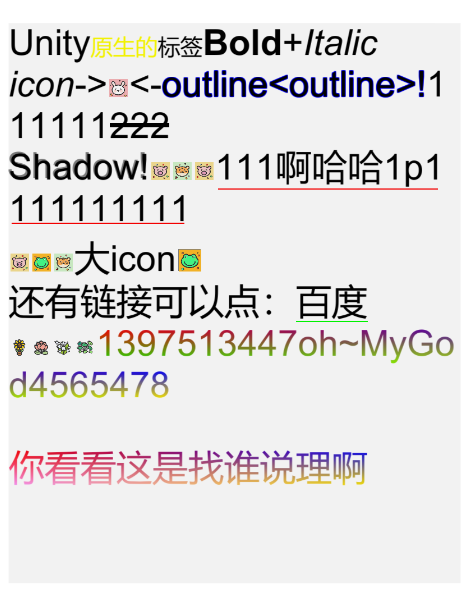

# SSRichText

[](https://github.com/SlipperSoar/SSRichText/releases/latest)
[](LICENSE)
[](https://unity.com/)
[](https://github.com/SlipperSoar/SSRichText/stargazers)

基于 Unity 旧版 UI Text（UGUI Legacy Text）的富文本组件。在原生 `<b>`、`<i>`、`<size>`、`<color>` 之外，额外支持**描边、阴影、下划线、删除线、渐变、链接、内联图标与 GIF 动图**，并提供统一的点击回调。

> 本项目扩展的是 `UnityEngine.UI.Text`，**不适用于 TextMeshPro**。



## 特性

- **标签即排版**：描边、阴影、下划线、删除线、四角渐变都可以直接写在文本里，无需拆分多个 UI 节点。
- **内联图标与动图**：`<icon=name/>`、`<gif=name/>` 占用一个字符位，大小随字号自动变化；图标和动图会合并到临时贴图中渲染，不必为每个图标创建一个 `Image`。
- **统一点击事件**：所有标签共用一个 `OnClick` 回调，参数包含标签类型与对应内容，图文混排、点击文中链接或图标都很方便。
- **可替换资源来源**：`IIconProvider` / `IGifProvider` 可以接管图标与 GIF 的加载逻辑（图集、AB 包、远端等）。
- **GIF 自动管理**：首次显示时自动创建 `GifLoadManager`，后台解析、统一播放，闲置缓存会自动清理。
- 继承自 `Text`，原有属性（字体、字号、对齐、换行、`Raycast Target` 等）继续生效。

## 环境要求

| 项目 | 说明 |
| --- | --- |
| Unity | 2021.2 及以上（代码使用 C# 9 语法；在 2021.3.27f1 上实测） |
| UI 系统 | UGUI（`com.unity.ugui`）的 Legacy `Text` |
| 其它依赖 | 无。运行时不需要额外包，也不依赖 TextMeshPro |

## 安装

### 方式一：UPM（推荐）

1. 打开 `Window > Package Manager`
2. 点击 `+` → `Add package from git URL...`
3. 填入：

```text
https://github.com/SlipperSoar/SSRichText.git?path=/Assets/SSRichText
```

需要固定版本时在末尾追加 tag，例如：

```text
https://github.com/SlipperSoar/SSRichText.git?path=/Assets/SSRichText#v2.0.0
```

也可以直接写进 `Packages/manifest.json`：

```json
{
  "dependencies": {
    "com.github-slippersoar.ssrichtext": "https://github.com/SlipperSoar/SSRichText.git?path=/Assets/SSRichText#v2.0.0"
  }
}
```

### 方式二：.unitypackage

前往 [Releases](https://github.com/SlipperSoar/SSRichText/releases/latest) 下载 `SSRichText.unitypackage`，拖入 Unity 编辑器即可。

### 方式三：克隆仓库

仓库本身就是一个可运行的示例工程（Unity 2021.3.27f1）。克隆后用 Unity 打开，运行 `Assets/Scenes/SampleScene.unity` 可以看到所有标签的实际效果。

## 快速开始

1. 在 Canvas 下通过 `GameObject > UI > SS > Rich Text` 创建，或在已有 UI 物体上 `Add Component` 搜索 `UI/SS/RichText`。
2. 在 `Text` 输入框中填写带标签的文本，例如：

```text
<color=#ff8844>公告</color><b>服务器</b><i>维护</i>通知
<outline=#000000>描边</outline> <underline=#00ff00>下划线</underline> <s>删除线</s>
<shadow=rb>右下阴影</shadow> <link=https://unity.com>打开官网</link> <link=www.unity.com>无协议链接</link>
<gradient lt=#ff0000 rt=#ffff00 lb=#00ff00 rb=#0000ff>四角渐变</gradient>
<icon=heart/> <gif=cat/>
```

3. 订阅点击事件：

```csharp
using SS.UIComponent;
using UnityEngine;

public class RichTextExample : MonoBehaviour
{
    [SerializeField] private RichText richText;

    private void Start()
    {
        richText.OnClick += OnRichTextClick;
    }

    private void OnDestroy()
    {
        richText.OnClick -= OnRichTextClick;
    }

    private void OnRichTextClick(RichText.RichType type, string message)
    {
        switch (type)
        {
            case RichText.RichType.Link:
                Application.OpenURL(message);
                break;
            default:
                Debug.Log($"[{type}] {message}");
                break;
        }
    }
}
```

## 标签参考

| 标签 | 示例 | 说明 |
| --- | --- | --- |
| 粗体 | `<b>text</b>` | Unity 原生标签 |
| 斜体 | `<i>text</i>` | Unity 原生标签 |
| 字号 | `<size=24>text</size>` | Unity 原生标签 |
| 颜色 | `<color=red>text</color>` | Unity 原生标签 |
| 删除线 | `<s>text</s>` | 颜色跟随当前文字颜色，线宽随字号变化 |
| 描边 | `<outline=red>text</outline>` | 必须带颜色参数；支持颜色名或十六进制 |
| 阴影 | `<shadow=lt>text</shadow>` | 方向：`lt` 左上、`rt` 右上、`lb` 左下、`rb` 右下 |
| 下划线 | `<underline=red>text</underline>` | 必须带颜色参数 |
| 渐变 | `<gradient lt=red rt=red lb=red rb=red>text</gradient>` | 需要给出四个角的颜色，可分别使用颜色名或十六进制 |
| 链接 | `<link=www.unity.com>text</link>` | 支持 `https://` 等协议，也可省略协议头（自动补 `https://`） |
| 图标 | `<icon=heart/>` | 默认从 `Resources` 读取 `Sprite`，可通过 `IIconProvider` 替换 |
| 动图 | `<gif=cat/>` | 默认从 `Resources` 读取 `.bytes`，由 `GifLoadManager` 自动解码播放 |

### 颜色写法

| 写法 | 示例 |
| --- | --- |
| 颜色名 | `white`、`black`、`red`、`green`、`blue`、`yellow`、`cyan`、`magenta`、`gray`、`grey` |
| 6 位十六进制 | `#ff8844`（不透明） |
| 8 位十六进制 | `#ff884480`（含 alpha） |
| 7 位十六进制 | `#ff88448`（自动把最后一位补成 alpha） |

> 十六进制中的字母大小写均可。无法解析的颜色会输出错误日志并退化为透明色。

## 点击事件

所有标签共用一个事件：

```csharp
public event Action<RichText.RichType, string> OnClick;
```

| 标签 | 回调参数 `type` | 回调参数 `message` |
| --- | --- | --- |
| `<link=url>` | `RichType.Link` | 标签中的 url；不带协议头时会补全成 `https://...` |
| `<icon=name/>` | `RichType.Icon` | 图标名 |
| `<gif=name/>` | `RichType.Gif` | 动图名 |
| 其它标签 | 对应的 `RichType` | 标签包裹的文本内容 |

补充说明：

- 同一位置有多个标签重叠时，按 `RichType` 枚举顺序取优先级最高的一个：删除线 > 动图 > 图标 > 链接 > 下划线 > 阴影 > 描边 > 渐变 > 字号 > 颜色 > 粗体 > 斜体。
- `<link>` 既支持带协议头的地址（`http://`、`https://`、`file://`、`mailto:`、`tel:` 以及自定义 scheme），也支持省略协议头的写法（`www.unity.com`、`unity.com/docs`、`localhost:8080`、`127.0.0.1:8080`）。省略协议头时，回调里收到的是补全后的 `https://...` 地址，可以直接交给 `Application.OpenURL`。
- `<link=hello>` 这类既没有协议头、也不像域名的内容不会被识别为链接，会原样显示为文本。
- 文本外层必须开启 `Raycast Target`，并且 Canvas 上有 `GraphicRaycaster`，才能收到点击。

## 图标

默认的 `IconProvider` 从 `Resources` 中按名字读取 `Sprite`：`<icon=heart/>` 等价于 `Resources.Load<Sprite>("heart")`，所以图片需要导入为 `Sprite` 类型。

自定义来源只需实现 `IIconProvider`：

```csharp
using SS.UIComponent;
using UnityEngine;

public class MyIconProvider : IIconProvider
{
    public Sprite GetIcon(string iconName)
    {
        return MyAtlas.Get(iconName); // 换成你自己的图集 / AB 包 / 远端加载
    }
}

// 只对当前组件生效
richText.SetIconProvider(new MyIconProvider());

// 或设置全局默认
RichText.GlobalIconProvider = new MyIconProvider();
```

注意事项：

- 图标名只支持字母、数字以及 `_`、`-`、`(`、`)`、`.`，不支持空格与目录分隔符，因此默认加载方式只能命中 `Resources` 根目录下的资源。
- 图标占一个字符位，尺寸随字号变化；找不到图标时，占位字符保持透明，不会显示乱码方块。
- `<shadow>` 同样作用于图标，并支持四角方向。

## GIF 动图

1. 把 `.gif` 文件拖进工程：`GifImporter` 会自动把它转换成同名 `.bytes`，并**删除原始 `.gif` 文件**（请先用版本管理提交备份）。
2. 把 `.bytes` 直接放到某个 `Resources` 目录下（例如 `Assets/Resources/cat.bytes`）。标签名不支持目录分隔符，所以放在子目录里无法被默认加载器找到。
3. 在文本中使用 `<gif=cat/>`。

运行时行为：

- 首次渲染时自动创建 `GifLoadManager`（`DontDestroyOnLoad`），在后台协程里解析字节数据并按帧延迟统一播放。
- 120 秒未被使用的 GIF 数据会自动卸载；需要常驻时可以传 `dontClear: true`。
- 自定义加载来源：实现 `IGifProvider.GetGifBytes(string gifName)` 并赋给 `GifLoadManager.Instance.GifProvider`。
- 直接塞入帧动画（不经过 GIF 解析）也可以用 `AddGifData`。

```csharp
// 1. 自定义字节来源（图集 / AB 包 / 远端）
public class MyGifProvider : IGifProvider
{
    public byte[] GetGifBytes(string gifName)
    {
        return MyBundle.LoadGifBytes(gifName);
    }
}

GifLoadManager.Instance.GifProvider = new MyGifProvider();

// 2. 直接提供帧序列
GifLoadManager.Instance.AddGifData(
    gifName: "myAnim",
    size: new Vector2Int(128, 128),
    gifFrames: frames,      // IEnumerable<GifData>，每帧含 Texture2D 与时长
    dontClear: true);
```

> GIF 的透明背景如果出现黑底/色块，可以在首次显示前调用 `GifLoadManager.Instance.PrepareGif(name, forceBgColorTransparent: true)` 强制把背景色置为透明。

## 编辑器工具

| 入口 | 作用 |
| --- | --- |
| `Window > SS > GIF Viewer` | 预览 `.gif` 或 `.bytes` 的解码结果、帧数与尺寸 |
| 导入 `.gif` | 自动转换成 `.bytes`，方便 `Resources` 加载 |

## 已知限制

- 仅支持 Legacy `Text`，不支持 TextMeshPro。
- `<gif>` 内部的文本（例如把文字叠在动图上）不会参与渲染，这部分扩展块目前只占位。
- 图标与动图各占一个字符位，超大图片会被压缩到该字符格内显示。
- GIF 解码在协程中完成，超大 GIF 首次显示会有一定开销。
- 关闭 `supportRichText` 会退化为原生 `Text` 的行为，扩展标签不再生效。
- 代码中用到了 C# 9 的 `is not` 模式（3 处）与目标类型 `new()`（2 处），所以 Unity 2020.3 LTS（C# 8）无法直接编译；如需支持 2020.3，把这 5 处语法改写为 C# 8 写法即可。

## 目录结构

```text
Assets/SSRichText/                 # 可独立分发的 UPM 包
  Runtime/Scripts/                 # RichText、IconProvider、GIF 解码与加载
  Runtime/Shaders/                 # 图标/动图合并贴图用的 Shader
  Editor/                          # GIF Viewer 与导入处理（独立 Editor 程序集）
Assets/Scenes/SampleScene.unity    # 示例场景
Assets/Scripts/Sample/             # 示例脚本
Assets/Resources/                  # 示例用的图标与 GIF 数据
```

## 更新日志与路线图

- 版本变更见 [CHANGELOG.md](CHANGELOG.md)
- 已实现：描边、阴影、下划线、删除线、渐变、链接、图标、GIF、点击事件
- 尚未实现：把 `<gif>` 内的文本渲染到动图帧上（扩展块不参与画面渲染）

## 致谢

- 实现思路来自 [ZUIRichText](https://github.com/172672672/UGUI-RichText)
- GIF 解码思路来自 [UnityGif](https://github.com/SleepyLoser/UnityGif) 与 [GIF 图解和压缩详解](https://blog.csdn.net/wzy198852/article/details/17266507)
- 示例图标来自阿里图标库：[大头贴](https://www.iconfont.cn/collections/detail?cid=50743)、[多彩小植物](https://www.iconfont.cn/collections/detail?cid=50664)
- 示例 GIF 来自网络

## 许可证

[MIT](LICENSE)

---

## English Summary

**SSRichText** is a rich text component for Unity's legacy UGUI `Text`. It keeps the built-in `<b>`, `<i>`, `<size>` and `<color>` tags and adds `<outline>`, `<shadow>`, `<underline>`, `<s>`, `<gradient>`, `<link>`, `<icon>` and `<gif>`, plus a single `OnClick` event for every tag.

- Requires Unity 2021.2+ and UGUI Legacy `Text` (not TextMeshPro).
- Install via UPM: `https://github.com/SlipperSoar/SSRichText.git?path=/Assets/SSRichText` (append `#v2.0.0` to pin a version), or download the `.unitypackage` from [Releases](https://github.com/SlipperSoar/SSRichText/releases/latest).
- Icons and GIFs are resolved through `IIconProvider` / `IGifProvider`, both defaulting to `Resources`.
- Licensed under the [MIT License](LICENSE). Full documentation (Chinese) is above.
